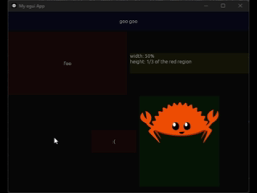

<p align="center" style="text-align:center">
  
</p>

# Marquee is a small crate that brings selection areas to [egui](https://github.com/emilk/egui)

## AI Policy

No LLM-generated content, whether it be code or
prose.  [Code of Conduct](https://rust-lang.org/policies/code-of-conduct/)



## Super-simple how to
```rust
use egui_marquee::Interactive;

egui_marquee::Marquee::new(egui::Id::unique("area"))
    .stroke(Stroke::new(1.0, Color32::RED))
    .show(ui, |ui| {
        let label = egui::Label::new("Foo Bar").interactive(Id::unique("test_area"))
        .inside(|label, area_ids, ui| {
          *label = egui::Label::new("boogoo gaga");
          }
        );

        ui.add(label);
    });

```


### Roadmap

- [x] Rect area drawing with customizable fill and stroke.
- [x] Interactivity expressed via "Interactive" trait
    - [x] Widget blanket implementation.
    - [x] inside / outside handlers
- [ ] Pass egui::Shape as the area shape.
- [ ] Persisted areas (option to define / spawn multiple areas).